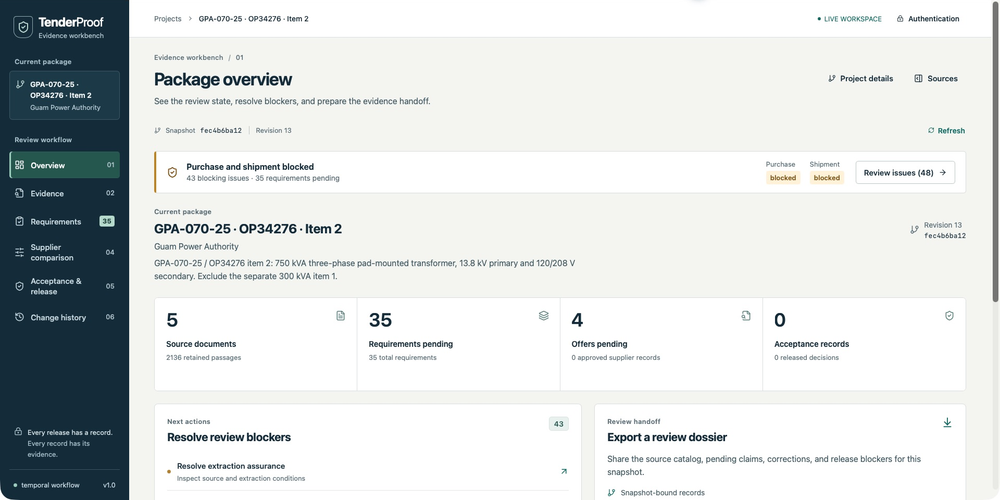
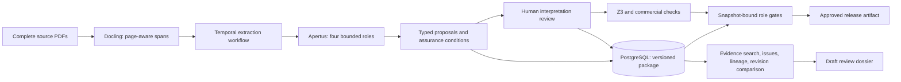

# TenderProof

TenderProof connects transformer procurement claims to their source evidence and review decisions. Apertus proposes engineering claims. Reviewers inspect original pages, compare revisions, and export a reproducible dossier. Purchase and shipment approvals belong to the reviewed package revision.

The application starts with an empty `default` project. It includes no business records, role-switching shortcut, or simulated model fallback. The source catalog links authentic Guam Power Authority procurement PDFs. Operators fetch the originals separately.

[Supporting slides](https://vishwa-docs.github.io/TenderProof/) · [Application-only video script](demo.md) · [Judge quickstart](docs/JUDGE_QUICKSTART.md) · [Technical report](track_2b/SwissChivers_Report.pdf) · [Official submission portal](https://hackapertus.ch/online-hack/submissions)



## Investigate a procurement decision

The workbench connects six workspaces. Its overview shows the current review workload and release conditions.

| Workspace | Implemented action | Evidence boundary |
| --- | --- | --- |
| Overview | Prioritize blocking issues and open the relevant record | Status follows existing release checks |
| Evidence | Search original passages, inspect adjacent context, and open source pages | BM25 ranks lexical relevance; duplicate citations remain visible |
| Requirements | Review structured commitments and distinguishing examples | Pending interpretations require separate engineering review |
| Supplier comparison | Inspect offers, price bases, and audited corrections | Corrections preserve original output and require approval |
| Acceptance & release | Check evidence applicability and role approvals | Missing unit evidence blocks shipment |
| Change history | Compare stored revisions and inspect changed values | Comparisons identify changed records and source links |

Export a draft dossier from the overview. JSON preserves source hashes, pending claims, corrections, review issues, and the exact snapshot.
The readable Markdown export summarizes the same packet. A content hash identifies the canonical JSON packet.
Draft exports grant no approval.

Source coverage counts cited spans. It does not measure extraction recall.
The lineage view follows stored document and record references. It does not certify a claim's meaning.
Search and revision comparison run locally without model inference.

See the [workbench contracts](docs/EVIDENCE_WORKBENCH.md) and [reference analysis](docs/REFERENCE_REWORK.md).

## Recorded result

The recorded case covers OP34276 item 2: three 750 kVA transformers, with 13.8 kV primary and 120/208 V secondary. The package excludes the separate 300 kVA item 1.

| Evidence | Recorded result | Review consequence |
| --- | --- | --- |
| Genuine model execution | Apertus v1.5 8B completed five source-kind runs across four authentic PDFs | Completion does not establish extraction accuracy |
| Execution history | 15 attempts: five completed, ten failed; 64 raw call triplets | Raw traces include failed attempts |
| Full tender | The pipeline supplied all 57 pages: 1,214 spans across six windows; 427.118 seconds | One truncated audit and one 15-row cap remain unresolved |
| Proposals | 35 requirements and four offers remain pending | No qualified approval or release |
| PO price correction | Model proposal: USD 111,316.50; corrected unit price: USD 37,105.50 | AI assistant source reading awaits qualified review |
| Acceptance evidence | No applicable completed FAT, unit serial/nameplate, or approved final unit drawing | Purchase and shipment gates remain blocked |
| Software QA | 380 backend tests and 51 frontend tests passed | Regression coverage does not measure model accuracy |

The model entered the three-unit line total in the unit-price field. The correction cites purchase order PDF page 4 and preserves the original output. The GPU endpoint remains stopped. The operator restored borrowed workloads after recording.

See the [verification record](track_2b/submission/VERIFICATION.md) and [source provenance](docs/REAL_DATA_SOURCES.md) for execution evidence and limitations.

## Architecture and review controls



Compose runs the API, worker, PostgreSQL, Temporal development server, and loopback gateway. The recorded model ran on a participant-controlled GPU host through a private authenticated relay. The operator must document the actual hosting location and data boundary. This prototype has no certified air gap or demonstrated Swiss residency.

| Control | Mechanism | Limit |
| --- | --- | --- |
| Source provenance | Original PDFs retain source URLs, SHA-256 hashes, and page/span locators | OCR and extracted meaning require review |
| Apertus output | Four bounded roles return typed proposals | Models cannot grant approval or emit executable verifier code |
| Extraction assurance | The package retains rejected rows, caps, gaps, and failed audits | Unresolved conditions block release |
| Numerical verification | Z3 checks supported constraints after unit normalization and consistency checks | Results concern encoded statements, not physical certification |
| Commercial verification | Integer minor units preserve amounts; explicit price bases distinguish unit and lot values | Unknown bases and incompatible units remain conditional |
| Change control | Content changes stale prior decisions and trigger full-package reassessment | The prototype omits selective incremental reassessment |
| Purchase approval | Engineer and Commercial authority approve the exact snapshot | The initial engineer principal cannot satisfy every role |
| Shipment approval | Inspector and Commercial authority approve the exact snapshot | Missing acceptance evidence remains unknown |

The team has not completed an expert-labeled held-out accuracy benchmark.
The prototype has no external ERP write or implemented workflow for scoped assurance resolution.
The new investigation tools do not change recorded model outputs or clear unresolved extraction conditions.
See the [technical report](track_2b/technical_report.md) for the supported representation and evaluation limits.

## Run with Docker

Install Docker with Compose and Python 3.11 or newer. Initial image, package, and model-artifact downloads require network access. The image includes Docling and prefetched parser/OCR assets. The first build is substantial.

```sh
cp .env.example .env
make setup-access
# Configure LLM_BASE_URL, LLM_NAME and LLM_API_KEY in .env for your actual endpoint.
make run
```

Open [http://localhost:8001](http://localhost:8001). Sign in with the private token in `.runtime/operator_token`. Setup generates a database password and an engineer principal. Setup restricts the principal to `default`. Setup creates no procurement data.

Preserve `.env` and Docker volumes between runs. `make stop` stops the stack and preserves its named volumes.

`LLM_BASE_URL` must include `/v1`. The app and worker must reach that URL. `LLM_NAME` defaults to `swiss-ai/Apertus-v1.5-8B`. The server must run the configured Apertus model. Extraction requires an actual inference service; source review can start without one. An empty endpoint returns an unavailable response.

The checked-in relay targets a separately configured host tunnel at port 18102. It does not provision a model. Read [model access and deployment](track_2b/docs/MODEL_ACCESS.md) before using it.

`LLM_TIMEOUT_SECONDS` defaults to 300 per role; its allowed range is 1-900. Successful traces record provider response IDs, reported usage counters, and content hashes. Optional `APERTUS_TRACE_DIR` stores exact request/response bodies in private UUID directories. Archives include invalid content and source text, but exclude authorization headers. Keep them in ignored local storage.

Large requirement documents use complete, page-aware windows of at most 48,000 text characters. Each window runs all four roles. The pipeline retains every original span and saves valid candidates after all windows complete. Invalid rows and failed structured audits remain blocking assurance conditions. Cross-window interpretation and unencoded obligations require human review. See [source windows and workflow deadlines](docs/REQUIREMENT_SOURCE_WINDOWS.md).

## Review real sources

Set the project name, customer, and exact equipment scope before extraction. Upload complete originals in the workbench. Inspect source pins and proposals before approval.

Configure additional authorized identities in `TENDERPROOF_PRINCIPALS_JSON`. The initial engineer token cannot perform every role.

Fetch and upload the five cataloged GPA-070-25 PDFs to a running local instance:

```sh
make setup
make ingest
```

Ingestion uses `.runtime/operator_token` and targets `http://127.0.0.1:8001`. It scopes the project to OP34276 item 2 and excludes the separate 300 kVA item. The process stores complete originals with source URLs and SHA-256 hashes. Claims remain unapproved.

Override `TENDERPROOF_API_URL` and `TENDERPROOF_API_TOKEN` when needed. Downloads and receipts stay under ignored `.runtime/`.

The five attachments contain 95 pages with overlapping tender, specification, and amendment material. They contain no applicable completed factory acceptance test report or verified serial-number match. Delivery is 24 weeks after GPA approves drawings. No reviewed source establishes that approval date, so the project-relative deadline remains unknown. See [source provenance and limitations](docs/REAL_DATA_SOURCES.md) and [data licensing](track_2b/data/README.md).

## Develop and verify locally

Use SQLite and direct extraction for local API development:

```sh
make setup
make documents
make build
make dev
```

`make dev` loads `.env` and uses `.runtime/docling` with offline model lookup. It serves the built workbench at [http://localhost:8000](http://localhost:8000). Prefetch assets with `make documents` while network access is available. Leave `DATABASE_URL` and `TEMPORAL_ADDRESS` unset for SQLite/direct mode. Change Docker-internal model URLs to endpoints reachable from the host. Frontend builds require Node.js 22 and npm.

```sh
make check
```

This command runs backend and frontend regression tests, checks TypeScript, and builds the UI. Isolated fixtures under `track_2b/tests/` verify software behavior. They never populate the demonstration or measure Apertus accuracy.

Read [deployment verification](docs/DEPLOYMENT_VERIFICATION.md) for measured checks and limitations. The read-only scripts `scripts/container_smoke.py` and `scripts/temporal_smoke.py` inspect an existing deployment without adding business data.

## Repository and submission

| Resource | Purpose |
| --- | --- |
| [Track 2B challenge](track_2b/README.md) | Mandatory files and challenge definition |
| [Submission requirements](track_2b/docs/SUBMISSION_REQUIREMENTS.md) | Verified delivery requirements |
| [Prior art and market evidence](docs/PRIOR_ART_AND_MARKET.md) | Sources for precedents and reused foundations |
| `track_2b/src/tenderproof/` | Python backend |
| `track_2b/src/web/` | React workbench |

Version control and the Docker build context exclude runtime credentials, original third-party PDFs, local databases, and model caches. The repository follows the [official template](https://github.com/HackApertus/project-template) by preserving `track_2b/` and removing unrelated tracks.

The [supporting deck](https://vishwa-docs.github.io/TenderProof/) includes keyboard navigation, phone scaling, and inline editing. Press E to edit text; use Save HTML to export changes. The [application-only script](demo.md) defines the recording sequence.

## Licences and attribution

Copyright 2026 SwissChivers. Team-authored code uses [Apache-2.0](LICENSE). Team-authored documentation and non-code outputs use [CC-BY-4.0](LICENSES/CC-BY-4.0.txt). The team's source-catalog metadata uses [CDLA-Permissive-2.0](LICENSES/CDLA-Permissive-2.0.txt).

See the [scope and third-party notices](NOTICE.md). Original procurement PDFs, upstream template material, dependencies, and model assets retain their own rights and notices. This repository grants no new rights in third-party PDFs. It does not distribute model weights.
