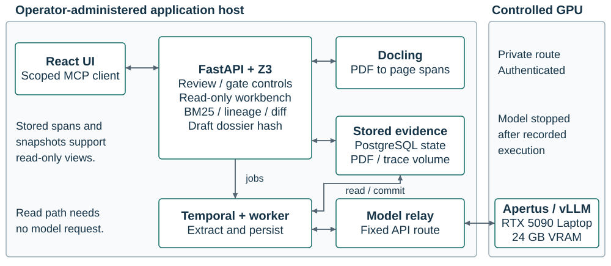
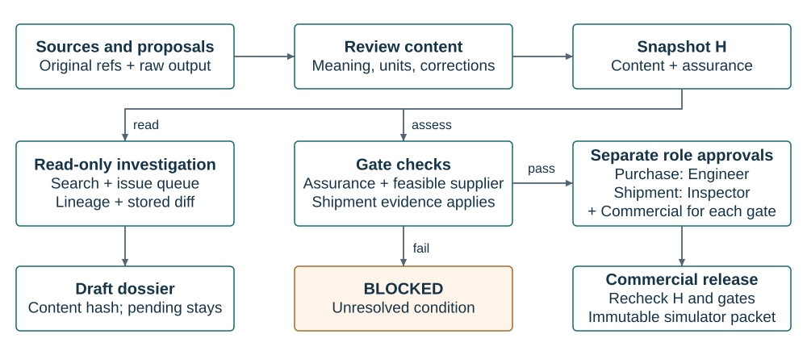

# Technical report - TenderProof

- **Track:** Track 2B
- **Event:** Online
- **Team:** SwissChivers; team members pending
- **Demo:** Final public application video URL pending

Document TP-TR-001, revision 2. Prepared 16 October 2026. Status: submission review; participant details and demo URL pending.

## 1. Summary

TenderProof helps EPC package engineers check equipment purchases against customer obligations and acceptance evidence. Apertus proposes source-linked records for human review. Deterministic checks assess encoded constraints. The workbench exposes source passages, review issues and stored revisions. Role approvals apply to the exact reviewed package snapshot. The real case retains 35 pending requirements and four pending offers. Unresolved findings block release. No customer outcome has been measured.

The case covers GPA-070-25, purchase order OP34276, item 2: three 750 kVA transformers. The required voltages are 13.8 kV primary and 120/208 V secondary. Item 1, a 300 kVA transformer, is outside scope. Guam Power Authority is the source publisher. The project claims no customer or partner relationship. [G1, G5]

## 2. Architecture

### Target architecture (mandatory)

Target a) on-premise: the operator administers application services, document storage and model execution. Docker hosts React, FastAPI, PostgreSQL and Temporal. The recorded deployment used a participant-controlled Linux GPU host through a private authenticated relay. Swiss geographic residency and certified air-gap operation remain unverified.

The six workspaces are Overview, Evidence, Requirements, Supplier comparison, Acceptance & release, and Change history. Each workspace uses the project's recorded state.

Figure 1. The workbench reads stored evidence through FastAPI. Temporal workers perform extraction. Read-only investigation requires no model request. [R1-R3, R10]

<!-- PAGEBREAK -->

### Evidence and snapshot controls

The service hashes canonical package content and extraction assurance. Content changes create new snapshots. Prior decisions become stale. The service reassesses the whole package. Historical snapshots and released packets retain their contents.

Figure 2. Read-only exports retain pending claims. Gate checks precede decision creation, approval and release. Required roles need separate people. [R1, R10]

| Control | Implemented mechanism | Engineering purpose |
| --- | --- | --- |
| Source retrieval | Deterministic BM25 ranks stored spans after numeric normalization. | Return original passages with page and span citations. |
| Duplicate citations | Exact text after whitespace normalization shares one result group. | Expose repeated passages without independent corroboration claims. |
| Review traceability | Stored references connect documents, proposals, corrections and decisions. | Navigate actual lineage and retained correction history. |
| Revision comparison | Diff compares exact stored project snapshots and preserves before/after values. | Inspect recorded changes and linked source references. |
| Draft dossier | Export includes pending records, source hashes and unresolved conditions. | Identify packet content through a deterministic hash. |
| Engineering gates | Z3 checks consistency before implication; applicability checks revision, configuration and required serial. | Block unsupported engineering conclusions. |
| Release control | Assurance conditions, role approvals, expected hash and SQL operation identity guard writes. | Reject unresolved conditions, stale writes and duplicate operations. |

### Build and runtime dependencies

Build preparation downloads locked Python/npm packages, Docker images, Docling assets, pinned model weights and source PDFs.

Application runtime uses PostgreSQL, Temporal and local document assets. Inference additionally requires Linux, NVIDIA drivers, the pinned vLLM image and the authenticated relay. Read-only workbench routes use existing application services.

<!-- PAGEBREAK -->

## 3. Use of Apertus

TenderProof uses inference with `swiss-ai/Apertus-v1.5-8B`. The recorded model revision is `ef4bbc54d6fe658bc782280ff9f3b53a10a9758f`. The project performed no fine-tuning. The model emits typed JSON. It cannot supply executable verifier code. The lifecycle verifies model files against the pinned manifest. [M1, R4]

The workbench adds no inference calls. Its release claims no improvement in semantic extraction accuracy.

| Setting | Recorded configuration | Reproduction detail |
| --- | --- | --- |
| Hardware | RTX 5090 Laptop GPU, 24 GB VRAM; Linux | Participant-controlled GPU host |
| Serving | Official Swiss AI vLLM image | Digest: `d85533f251c8272218ae2e519510836376e5a335b44f2204f193018e37753bc6` |
| Memory | 32,768-token context; GPU utilization 0.89 | 2 GiB CPU offload; one sequence; 2,048 batched tokens |
| Decoding | Temperature 0; thinking disabled; text-only requests | Server-enforced JSON schema; row validation |

Each window uses four prompts: document interpreter, obligation mapper, evidence analyst and adversarial challenger. One model performs every role. Role agreement provides no independent validation. Prompts and schemas reside in `integrations.py`. The requirements mapper allows 15 rows per window. Audit responses allow 800 output tokens.

The full tender supplied 1,214 spans through six windows. That run made 24 raw model calls. One audit response truncated at 800 tokens. The saved run telemetry originally linked 23 calls. Later evidence review identified the missing raw trace. Historical records retain the original linkage. [R2, R5]

## 4. Data

| Complete source | PDF pages | Completed extraction result |
| --- | --- | --- |
| OP34276 purchase order [G1] | 9 | One offer, 49.243 s; two requirements, 41.281 s |
| E-004 Revision 10 [G2] | 20 | Parsed separately; inference used its scans inside the full tender |
| GPA-070-25 bid abstract [G3] | 5 | Three offers, 33.871 s; bidder/item price errors remain |
| Issuance and amendments [G4] | 4 | Zero saved requirements, 50.091 s; 11 invalid rows rejected |
| Full IFB plus Amendment I [G6] | 57 | 33 requirements, 427.118 s; six windows |

The five attachments contain 95 pages with overlapping content. Full IFB pages 10-29 reproduce all 20 standalone E-004 scans. Later Amendments II and III remain necessary. Five completed source-kind runs cover four distinct PDFs. Every saved requirement and offer remains pending.

The provenance catalog records source URLs and SHA-256 hashes. Redistribution permission for the original PDFs remains unestablished. Complete originals stay in ignored local storage. The repository supplies fetch metadata. The source set comprises public procurement records. The project collected no human-subject study data. [R5, R6]

<!-- PAGEBREAK -->

## 5. Evaluation

The evaluation separates recorded model execution from current software verification. Model results date from 15 October 2026. Workbench checks date from 16 October 2026. Extraction accuracy remains unmeasured. [R5, R10]

| Setup or task | Metric | Observed result and scope |
| --- | --- | --- |
| Baseline | Plain retrieval or full-context accuracy; review time | Not measured. No comparative result is available. |
| Ours: real extraction | Attempts, completions and retained proposals | 15 attempts; five completed; ten failed. 35 requirements and four offers remain pending. |
| Software QA | Current regression tests and build checks | 380 backend and 51 frontend tests passed. TypeScript and production build passed. |
| Parsing | Conversion, pages, spans and characters | Five PDFs; 95 attachment pages; 2,136 spans; 342,307 retained characters. |
| Input delivery | Original spans present in mapper inputs | Completed runs matched source spans. Full tender supplied 1,214/1,214 spans. |
| Trace integrity | Preserved response and call-file hashes | All 15 run-response hashes and 192 hashes across 64 call triplets matched. |
| Workbench package | Current stored records and issue counts | Five documents; 2,136 spans; one correction. 48 issues include 43 blocking issues. |
| Persistence | Restart and duplicate-request behavior | Restart preserved state. A duplicate request attached to the active workflow. |
| Decision state | Pending records, approvals and releases | 35 pending requirements; four pending offers; zero approvals and releases. |

Regression tests use isolated constructed cases. Those cases do not populate the demonstration or model evidence. Four isolated reparses succeeded. The API separately parsed the full tender. A concurrent isolated parse failed with OOM/exit 137.

### Observed extraction errors

The bid abstract assigns prices to incorrect bidders or items. Some requirements mislabel properties, merge voltage values or include the excluded 300 kVA item. The full-tender output reached a 15-row window cap. Span delivery establishes input coverage. Requirement recall remains unknown.

### Source-linked price correction

The PO offer placed the three-unit line total, USD 111,316.50, in its price field. An audited assistant-assisted correction set USD 37,105.50 per unit. The correction cites OP34276 PDF page 4. The stored amount changed from 11,131,650 to 3,710,550 cents. Raw output and correction history remain intact. The offer remains pending without engineer approval. [G1, R7]

Delivery is 24 weeks after GPA approves drawings. The supplier offer preserves that basis. Extraction omitted a separate delivery requirement row. The reviewed sources contain no drawing-approval date. A due date calculated from the order date would lack source support.

<!-- PAGEBREAK -->

## 6. Limitations

### Engineering scope

Z3 results apply to supported encoded numerical statements. Missing operating conditions, unsupported representations and solver uncertainty return unknown. Physical equipment conformity requires separate evidence and review. Unencoded obligations remain outside the solver's coverage.

The current rule set targets transformer equipment. Evidence checks require applicable configuration and revision. Routine test evidence also requires the selected unit's serial. Design-family evidence requires explicit authorized coverage approval. A specification revision identifies the specification document. It does not identify the manufactured equipment's design revision.

The authentic source set contains no completed factory acceptance test, actual unit serial/nameplate or approved final unit drawing. Missing acceptance evidence leaves acceptance unknown. It does not establish supplier noncompliance. Amendment II answers the flip-top question "no". It does not establish an inspected unit's properties. [G4, R8]

### Retrieval, workflow and model limits

BM25 scores measure lexical relevance. Citation coverage counts referenced spans. These metrics provide no semantic accuracy or completeness measurement. An empty search result does not prove source absence. Lineage represents stored references without claim-support validation.

Search accepts 300 query characters and returns at most 50 groups. History lists the latest 100 snapshots. Graphs allow 500 nodes and 2,000 edges with truncation notices. Responses have an 8 MiB limit. The API bounds larger source sets. [R10]

All five persisted extraction runs have incomplete assurance. Failed audits, rejected rows, output caps and unresolved findings remain attached to the snapshot. The prototype has no scoped assurance-resolution workflow. Purchase and shipment gates therefore remain blocked for this case.

A correction changes proposal fields without approval. Model audit prompts missed some errors. The project has no expert-labeled held-out benchmark. Its 35 source-reference facts remain assistant-reviewed. The inference pipeline never receives them as input.

Snapshot comparison inspects stored changes. Selective reassessment remains unimplemented. A draft dossier hash identifies exported content without approval authority. Release exports simulator packets. Production ERP integration remains unimplemented.

### Operational and commercial limits

Runtime route checks reached PostgreSQL, Temporal and the relay. Two tested public destinations were unreachable. Complete egress isolation remains unverified. Independent security, accessibility and load tests remain outstanding. Worker crash recovery during inference remains untested.

The model endpoint stopped after testing. The operator restored the borrowed GPU workloads. The application supports review of recorded state. New inference requires the model endpoint. The demo will show application screens and recorded results. The 427.118-second tender run exceeds the two-minute video limit.

A target of 20 customers at USD 250,000 annually implies USD 5 million in annual recurring revenue. Customer demand and pricing remain unvalidated. No customer savings, revenue or physical conformity result has been measured. Novelty and patentability remain unestablished. The report claims no ISO certification or formal ASD-STE100 conformance.

<!-- PAGEBREAK -->

## 7. Reproducibility

Application source/code commit: `c1141f19b5bde590b650b1f1215f692353f609ec`.

The evidence record is `track_2b/submission/REAL_SOURCE_EVIDENCE.json`. Its package version is 13. Its reviewed snapshot is `fec4b6ba125c296f9564f2e475ef6e441b1ee93a55a7ccbc2df826b2a2620ba6`. The recorded artifact-input review occurred at `2026-10-15T14:47:53.246633+00:00`.

Evidence file SHA-256: `87460c9fd3cd21b5ccf50aa234ff7db0739063001678f3324a91a2a2e6d9e691`.

The report footer records abbreviated SHA-256 hashes of the report source and evidence file. The standalone renderer retains full input and output hashes in its private build review. The public evidence record identifies source hashes, run responses and raw traces. Raw full-document traces remain local because source redistribution permission is unestablished.

1. Check out the application source/code commit above.
2. Run `make setup` to install application dependencies.
3. Run `make documents` to prepare Docling dependencies and assets.
4. Run `make check` to repeat software QA and build checks.
5. Run `make run` to start Docker application services.
6. Run `make sources` and `make ingest` to fetch and import the complete originals.
7. Configure the genuine Apertus endpoint before new extraction. [R4]
8. Select OP34276 item 2 and review each extracted proposal against its original page.

The workbench investigates recorded state without a running model. Five authenticated GET routes provide analysis, search, snapshots, diff and dossier export. Four new MCP tools expose analysis, search, diff and dossier export. The existing `prepare_purchase_draft` MCP tool still issues POST requests. Project authorization remains in the API. [R10]

`make run` does not start the remote GPU model. Initial downloads require network access. Section 3 records serving parameters. Requests do not set a seed. Repeated inference may differ. Preserved traces identify the recorded run.

For exact parsing context, use Docling 2.139.0, docling-core 2.101.1, PDFium 5.14.0 and RapidOCR 3.10.0. The strict parsing report records the isolated image identity and separate API conversion. [R9]

## 8. Next steps

The next month should establish an expert-reviewed baseline on independent procurement packages. Compare plain retrieval, full-context prompting and the complete workflow. Measure critical false acceptance, applicability precision/recall, review time, latency and cost. Split data by procurement package to avoid revision or translation leakage.

Implement scoped assurance review before enabling releases for incomplete runs. Test worker recovery during inference. Add source-supported acceptance evidence for a design partner's equipment. Measure deployment cost and review effort before extending equipment schemas or production ERP integration.

## License

Team-authored documentation and design use CC-BY-4.0. Team-authored code uses Apache-2.0. Team-owned annotations use CDLA-Permissive-2.0. Third-party documents retain their owners' rights. Model use remains subject to the pinned model's published terms. The repository excludes secrets, private deployment configuration, model weights and complete source PDFs.

<!-- PAGEBREAK -->

## References

G1. Guam Power Authority. [Purchase order OP34276](https://go.opengovguam.com/uploads/ggbids/packet_1765520985_OP%2034276.pdf), 13 October 2025. Nine pages; item 2 and price: PDF page 4.

G2. Guam Power Authority. [E-004 Revision 10](https://go.opengovguam.com/app/webroot/userfiles/files/Spec%20E-004%20Revision%2010%20-%20Three%20Phase%20Pad%20Mounted%20Distribution%20Transformer%282%29.pdf), 29 July 2022. Twenty pages.

G3. Guam Power Authority. [GPA-070-25 bid abstract](https://go.opengovguam.com/uploads/ggbids/packet_1765520985_GPA-070-25%20Bid%20Abstract.pdf), 16 September 2025. Five PDF pages.

G4. Guam Power Authority. [Issuance and amendments](https://go.opengovguam.com/uploads/ggbids/packet_1765520985_GPA-070-25%20IFB%20Issuance.pdf). Four PDF pages; Amendment II: page 2.

G5. Guam Power Authority. [Official award and attachment record](https://go.opengovguam.com/tenders/tender_details/gpa/GPA-070-25).

G6. Guam Power Authority. [GPA-070-25 IFB plus Amendment I](https://www.ppa.org.fj/wp-content/uploads/2025/08/220825GPA-GPA-070-25-with-Amendment-I.pdf). Pacific Power Association mirror; 57 pages.

M1. Swiss AI. [Apertus v1.5 8B model card](https://huggingface.co/swiss-ai/Apertus-v1.5-8B). Model revision appears in section 3.

R1. Application controls: `track_2b/src/tenderproof/service.py`, `domain.py` and `assurance.py`.

R2. Model prompts, schemas and source windows: `track_2b/src/tenderproof/integrations.py`.

R3. Workflow and persistence activities: `track_2b/src/tenderproof/workflows.py`.

R4. Deployment and model identity: [deployment guide](../docs/GPU_SERVING_LIFECYCLE.md), `deploy/apertus-model-manifest.json`, and [real integration findings](../docs/REAL_MODEL_INTEGRATION.md).

R5. Recorded run and verification evidence: [REAL_SOURCE_EVIDENCE.json](submission/REAL_SOURCE_EVIDENCE.json).

R6. Source provenance: [sources.json](data/sources.json) and [data notes](data/README.md).

R7. [Price correction review](../docs/PRICE_CORRECTION_REVIEW.md) and [independent code review](../docs/PRICE_CORRECTION_INDEPENDENT_REVIEW.md).

R8. [Real package review](../docs/REAL_PACKAGE_REVIEW.md) and [assistant-reviewed reference facts](data/evaluation/gpa-source-facts.json).

R9. [Strict source parsing](../docs/STRICT_SOURCE_PARSING.md) and [source window design](../docs/REQUIREMENT_SOURCE_WINDOWS.md).

R10. [Evidence workbench contracts](../docs/EVIDENCE_WORKBENCH.md), `track_2b/src/tenderproof/evidence_workbench.py`, `api.py`, `mcp_server.py` and `track_2b/src/web/src/WorkbenchPanels.tsx`.

R11. [Reference design decisions](../docs/REFERENCE_REWORK.md).

H1. Hack Apertus. [Official Track 2B template](https://github.com/HackApertus/project-template/blob/main/track_2b/technical_report.md) and [delivery requirements](https://github.com/HackApertus/project-template/blob/main/track_2b/README.md).

External source access date: 15 October 2026. Report revision date: 16 October 2026.
